  

  
  
  
  

Oi, eu sou o Matheus. Estudo Engenharia de Computação e desenvolvo aplicações web completas com TypeScript e Next.js, do banco de dados à interface.

## Com o que posso ajudar

<table>
  <tbody>
    <tr>
      <td><strong>Front-end</strong></td>
      <td>React, Next.js (App Router), Tailwind CSS, tema claro e escuro, interface em mais de um idioma.</td>
    </tr>
    <tr>
      <td><strong>Back-end</strong></td>
      <td>Route Handlers, Server Actions, validação com Zod, autenticação com Auth.js e segundo fator.</td>
    </tr>
    <tr>
      <td><strong>Dados</strong></td>
      <td>Modelagem em MySQL com Prisma e migrações versionadas.</td>
    </tr>
    <tr>
      <td><strong>Testes e CI</strong></td>
      <td>Vitest, Playwright, axe-core e GitHub Actions com auditoria de dependências.</td>
    </tr>
    <tr>
      <td><strong>IA aplicada</strong></td>
      <td>Moderação de texto e imagem com Gemini, sempre com revisão humana como rede de segurança.</td>
    </tr>
  </tbody>
</table>

## Projetos em destaque

-  - plataforma de reclamações urbanas: cidadãos registram problemas, órgãos públicos respondem oficialmente e quem reclamou avalia a resolução. Tem moderação assistida por IA, 228 testes unitários e 158 testes de ponta a ponta. 
-  - bot de economia e RPG para o Discord, no ar em [helena.discloud.dev](https://helena.discloud.dev/). Cada servidor tem a sua economia, com trabalho, banco, loja, duelos, casamento e crime. Desenvolvido com [agorismo](https://github.com/agorismo).
-  - jogo em Lua com LÖVE, inspirado no minijogo ConSumo de *Bully* e criado para a disciplina de Multimídia.

  
Capturas do Urban Grid

  <table>
    <tbody>
      <tr>
        <td align="center"> Página inicial</td>
        <td align="center"> Reclamação</td>
      </tr>
      <tr>
        <td align="center"> Painel do órgão</td>
        <td align="center"> Transparência</td>
      </tr>
    </tbody>
  </table>

## Tecnologias

- **No dia a dia:** TypeScript, JavaScript, React, Next.js, Tailwind CSS, Prisma, MySQL, Node.js, Docker, Vitest e Playwright
- **Também já usei:** Python, Lua, PHP, C# e MongoDB

## Estatísticas

  
  

## Contato

[LinkedIn](https://www.linkedin.com/in/mathxustonon/) · [X](https://twitter.com/mathxustonon) · [Instagram](https://www.instagram.com/mathxusreis/)

## Atividade recente

  
<strong>Clique para ver a atividade recente no GitHub</strong>

<!--INICIO:atividade-->
### Pull requests recentes

- 🟢 <a href="https://github.com/matheustonon1/project_game/pull/1"><strong>feat: visual refeito e duas versões do jogo</strong></a> 
  <code>matheustonon1/project_game</code> • 2026-11-02 • aberto
- 🟢 <a href="https://github.com/matheustonon1/urban-grid/pull/13"><strong>chore: adiciona o arquivo de licença MIT</strong></a> 
  <code>matheustonon1/urban-grid</code> • 2026-11-02 • aberto
- 🟣 <a href="https://github.com/matheustonon1/urban-grid/pull/12"><strong>chore(deps): Next 16.4.4, vulnerabilidades de produção de 11 para 1 e gate de auditoria no CI</strong></a> 
  <code>matheustonon1/urban-grid</code> • 2026-11-02 • mesclado
- 🟣 <a href="https://github.com/matheustonon1/urban-grid/pull/11"><strong>Redesign completo, retorno das ações e confirmações seguras</strong></a> 
  <code>matheustonon1/urban-grid</code> • 2026-10-23 • mesclado
- 🟣 <a href="https://github.com/matheustonon1/urban-grid/pull/6"><strong>feat: feed público, moderação, denúncia, antifake, upload de imagem e reforma visual</strong></a> 
  <code>matheustonon1/urban-grid</code> • 2026-09-09 • mesclado

### Repositórios atualizados

- <a href="https://github.com/matheustonon1/project_game"><code>project_game</code></a> • 2026-11-02 
  Jogo em Lua com LÖVE, inspirado no minijogo ConSumo de Bully. Criado para a disciplina de Multimídia de Engenharia da Computação.
- <a href="https://github.com/matheustonon1/urban-grid"><code>urban-grid</code></a> • 2026-11-02 
  Plataforma de reclamações urbanas com resposta pública de órgãos e moderação assistida por IA.
- <a href="https://github.com/matheustonon1/algoritmoafd"><code>algoritmoafd</code></a> • 2024-09-02
<!--FIM:atividade-->

